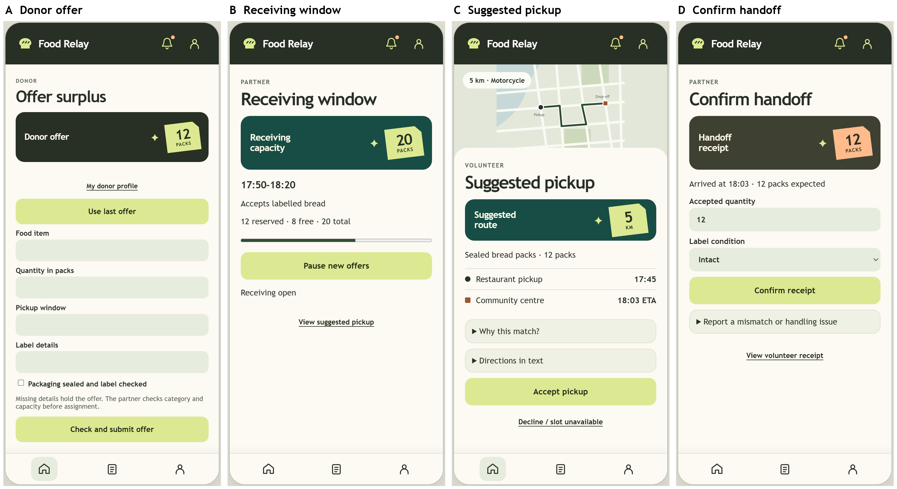
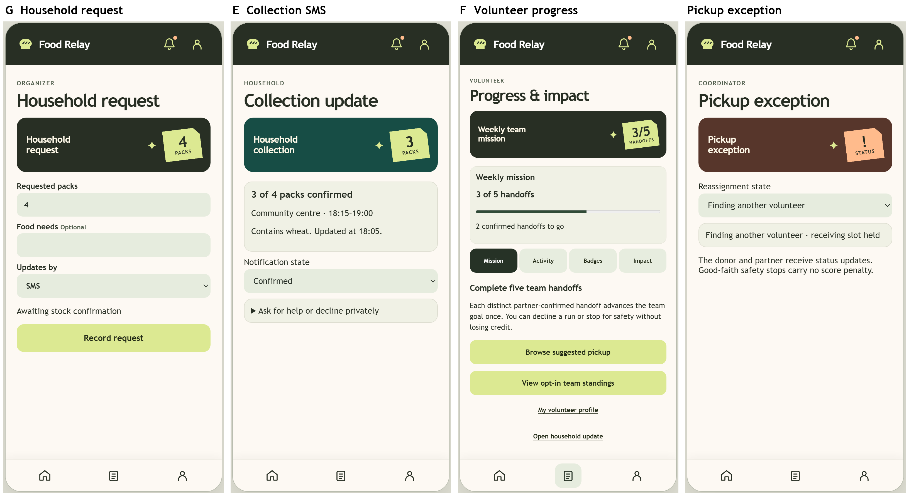
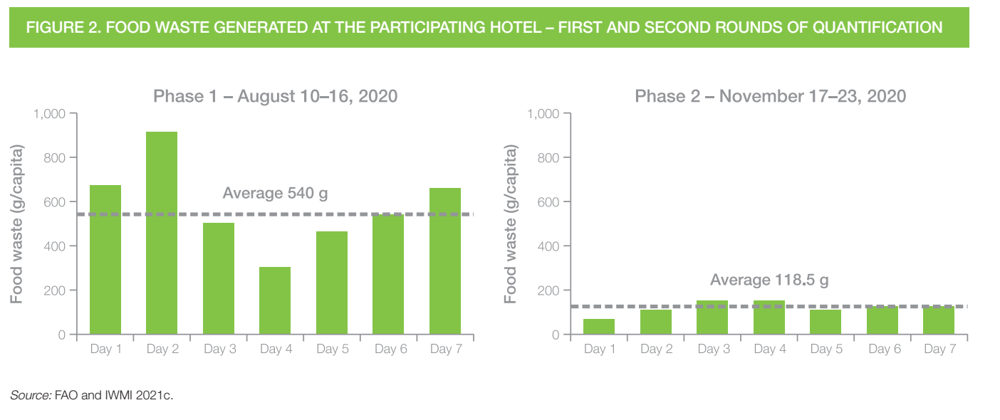
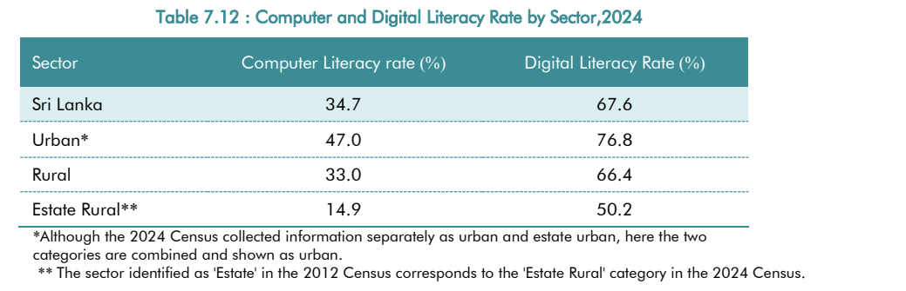
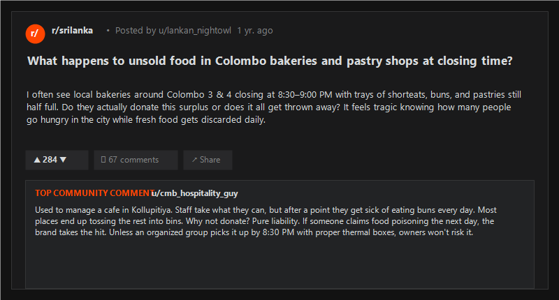
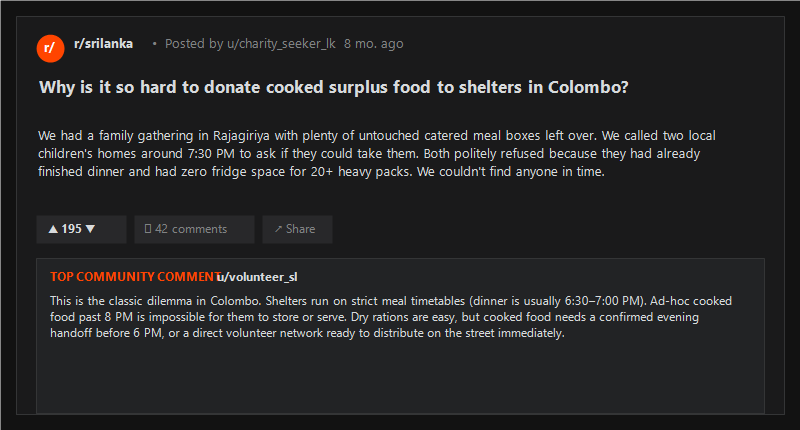
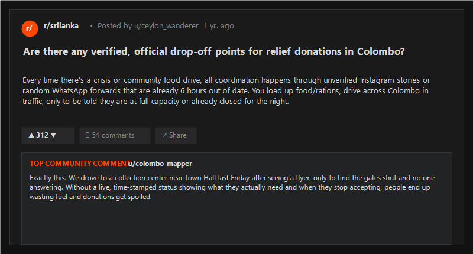

# A confirmed handoff for Colombo’s surplus food

**NEXUS 2026 UI/UX Challenge · Round 1 proposal**  
**Team:** [Replace with registered team name]

## Executive summary

A food business can have a batch ready to donate and still miss the chance to share it. A volunteer needs enough time to collect it, a receiving organization needs room and staff to accept it, and people receiving food need reliable information before they travel. In Colombo, published stakeholder interviews documented a short window between evening surplus release and demand at receiving institutions, alongside transport constraints and donor concerns about food handling and responsibility. [1]

We propose a food redistribution service focused on one evening handoff in one Colombo catchment. It checks a donation against a receiving partner’s availability and capacity, suggests a feasible run to a volunteer, and records what the partner actually accepts. The partner can then share a private, time-stamped availability update with recipients. The primary design decision is whether a volunteer can take a run confidently and what everyone should do when the plan changes.

## 1. Problem statement and Sri Lankan evidence

**Design question:** How might we help a volunteer, donor and receiving partner agree on a feasible evening handoff while giving recipients reliable, private information and the choice to decline?

This proposal draws on published stakeholder research, government statistics and public descriptions of existing redistribution services. The supplied screenshots add candidate pain points and illustrative personas. These are design inputs. The proposal uses secondary research and fictional scenarios.

| Evidence | What it means for the design |
| --- | --- |
| **Timing, transport and trust.** A 2021 Colombo study found that food released in the evening could have a short window to reach receiving institutions. Donors raised concerns about hygiene, liability and reputation, and local redistribution initiatives reported limits on volunteer time, transport and storage. The study’s mid-2019 Robin Hood Army account describes WhatsApp coordination for evening collections. [1] | A listing alone leaves several decisions open. The useful moment is when a partner can receive the specific food and a volunteer can complete the full trip. The evidence is historical and leaves the present frequency of missed handoffs open. |
| **How an evening pickup worked in practice.** Aloysius and Ananda’s 2023 Colombo study drew on 20 interviews with donors and redistributors conducted in 2021. In its Robin Hood Army case, donors sent the location and quantity to team leaders, who relayed them to volunteers through WhatsApp. Volunteers used their own vehicles, and the study describes supply and demand as unpredictable. [10] | This gives the prototype a concrete baseline: coordinate one pickup from the same quantity and location details, then compare how clearly each workflow communicates assignment, vehicle fit and exceptions. The interview sample covered donors and redistributors. Recipient preferences and present-day operating practices remain open. |
| **Different kinds of food waste require different responses.** In one Colombo hotel audit, 21% of prepared food was wasted during the initial assessment. Buffet surplus accounted for 46% of the measured waste, plate leftovers for 33%, and preparation waste for 21%. This was one participating hotel, and the initial assessment took place between COVID-related lockdowns. [2] | Screen donations by food category and handling requirements. The audit measured waste at one site. Eligible donation quantities in the proposed catchment are unknown. |
| **Food access matters beyond a single pickup.** WFP reported moderate food insecurity among 24% of households in its Sri Lanka survey conducted in August–September 2023. [3] | Reliable redistribution may support food access locally. The national historical figure cannot establish demand in the pilot catchment or the effect of the proposed service. |
| **Digital access varies.** Sri Lanka’s 2024 census reported digital literacy among people aged five and over at 67.6% nationally and 78.7% in Colombo district. The estate-rural rate was 50.2%. [4] | Keep the primary flow lightweight and let recipients get updates through a partner without creating an account. The census does not establish smartphone ownership, individual language preference or data affordability. |
| **Community discussions reveal acute donor liability and schedule mismatches.** Social listening on r/srilanka shows Colombo bakery managers discarding evening surplus due to food poisoning liability concerns, while donors attempting ad-hoc drops at shelters after 7:30 PM face rejection because dinner schedules (6:30–7:00 PM) and fridge limits were already reached. [Appendix A3–A5] | Ground the UX in clear donor liability waivers, pre-matched receiving windows before store closing, and live verified capacity indicators so volunteers and donors never attempt unfeasible drops. |

### Donor problems

- **Uncertain supply and demand.** The Colombo study documents short release windows and limits on receiving capacity. We assume the donor often knows the final quantity only near closing and may be unsure who can use it. Let staff reuse offer details and enter the actual quantity when known. Show which partner can receive it. [1]
- **Coordination takes time.** Local initiatives have used WhatsApp to organize pickups. Repeated calls, missed collections and extra work at closing are plausible friction points. Give the donor one status showing who has accepted the run, the pickup window and what happens on cancellation. [1]
- **Safety, trust and feedback.** Local donors expressed concerns about handling and responsibility. A further hypothesis is that limited feedback reduces confidence and recognition. Give donors a private receipt showing the quantity the partner accepted and its current status. Keep household identities private. [1]

### Volunteer problems

- **Finding an affordable, practical run.** Published accounts document limits on volunteer time and transport. We assume fuel costs, inconvenient locations and unclear tasks influence which offers volunteers accept. Show where help is needed, both stops, estimated total distance and time, and the load before commitment. [1]
- **A trip can fail at either end.** A donor or receiving partner may be unavailable on arrival, and a load may exceed a motorcycle’s carrying capacity. Show confirmed windows, carrying requirements, a verified contact and landmark directions. Give volunteers a way to report delays and concerns about an unfamiliar location. [1]
- **Several pickups and unclear responsibilities add friction.** Coordinating multiple stops and deciding how to handle a questionable batch are candidate problems. Start with one pickup and one drop-off, make handling responsibilities explicit, and give volunteers a way to stop and contact the coordinator. Test whether confirmed impact and optional team progress encourage people to return.

### Recipient problems

- **Uncertain availability and transport.** We assume that unclear times and locations, fluctuating quantities and limited transport can make a trip costly or futile. Share confirmed stock, a collection window and a private way to check or request a quantity before travelling.
- **Suitability and household needs.** One person may be collecting for several people. A household may need more food than is available or need to avoid particular ingredients. Show relevant label information and let the organizer record the quantity requested and what the partner can actually confirm. Route unsafe or uncertain batches to the receiving partner’s review.
- **Access, privacy and fairness.** The census supports designing for varied digital literacy. Limited mobile data, reluctance to request help publicly and concerns about unfair allocation are hypotheses. Offer a low-data view, phone and in-person requests, and a clear allocation policy that applies across channels. [3, 4]

The receiving partner connects these needs. We assume a staffed organization can set receiving limits, check incoming food, assign quantities and explain shortages. The Colombo study’s findings on receiving windows and storage inform that hypothesis. [1]

## 2. User personas

These are provisional personas. Device access, preferred language and the specific frustrations in each profile are assumptions.

| Persona | Context and goal | Frustrations | Design implication |
| --- | --- | --- | --- |
| **Busy donor · restaurant manager, 38** | Uses a smartphone during a busy closing shift. Wants to donate eligible surplus without disrupting closing duties. | Unpredictable leftovers, time spent coordinating and missed pickups. | Reuse business details for quick donation creation. Suggest a pickup automatically within confirmed windows and show its status through handoff. |
| **Occasional volunteer · university student, 23** | Has a motorcycle and uses mobile data. Wants to help during free time. | Fuel expenses, unclear tasks, unsuitable loads and inconvenient routes. | Offer flexible runs with both stops, total route estimates and carrying requirements. Show the verified result after drop-off. |
| **Community recipient representative · community organizer, 45** | Uses a basic smartphone with limited mobile data. Helps households access suitable food reliably. | Uncertain availability, insufficient quantities for households and concerns about food quality. | Let the organizer submit a simple quantity request on a household’s behalf, check food details and receive clear status updates on a low-data connection. |

The **community organizer** represents the recipient side. An adult collecting for their own household can make the same request directly, by phone or in person, and may decline an unsuitable allocation. The **receiving coordinator** sets capacity and receiving hours, checks the batch and confirms allocations. In a small partner organization, the same person might perform both roles.

## 3. Key user journey · an evening pickup

**Primary user:** The occasional volunteer. **Starting point:** The volunteer wants a nearby run that fits their evening. **End point:** The receiving partner confirms the batch or the team closes the attempt. The feelings and frictions below are hypotheses.

| Stage | What the volunteer does and feels | Friction | Proposed interaction |
| --- | --- | --- | --- |
| Find | Checks for a run that fits an evening slot. Interested, with limited time. | Fuel, travel time and the carrying needs of both stops may be unclear. | Shows pickup and receiving windows, total route distance and time, and load requirements in one text card. |
| Decide | Reviews the trip and accepts or declines. Cautious about overcommitting. | The donor or receiver may be unavailable, or the location may feel unfamiliar. | Explains why the run fits, confirms the assignment and receiving slot, and shows landmark directions and a support contact after acceptance. |
| Collect | Arrives and compares the label and quantity with the booking. Focused on getting it right. | The batch may differ from the offer or become unsuitable. | Shows pickup details and a visible “Report a problem” action. Route unresolved discrepancies to the coordinator. |
| Deliver | Hands the batch to the partner. Looks for confirmation. | An open door or volunteer check-in alone gives no record of what the partner accepted. | Partner records accepted quantity or a reason for rejection. |
| Close | Sees the outcome, with relief or disappointment. | The donor and volunteer may never learn what the partner accepted. | Shows the accepted quantity or closure reason. When stock is ready, the partner privately updates recipients or their organizer. |

**Recipient-side handoff:** The organizer or household requests a quantity through the partner. It appears as pending until the partner has accepted stock and can allocate it. If the partner can cover only part of the request, the update states the confirmed quantity, food details and pickup window. The household can decide whether the partial allocation is useful before travelling.

**Failure path:** If the volunteer cancels before pickup, the coordinator can offer the run to a backup who still meets the constraints. If nobody fits before the cutoff, the offer closes and the donor sees the outcome. If a problem occurs after pickup, the volunteer contacts the coordinator and follows the partner’s procedure. A partner can withhold or correct a recipient update when the food is unavailable.

## 4. Proposed solution and key features

We propose a mobile-first coordination tool for a verified food business, a volunteer and a staffed community food partner. The first prototype uses partner-approved, sealed, labelled bakery items from a restaurant or bakery and one receiving location. The food is shared free of charge through the partner. A real trial would require agreement from the partner and verification of applicable hygiene, handling and transport procedures with the relevant local authority. Sri Lanka’s Food (Hygiene) Regulations apply to establishments engaged in activities that include food transport, distribution, handling and storage. [5]

1. **Post an offer.** The donor starts from a reusable template and confirms the actual food category, quantity, label and relevant ingredient or allergen details, condition, handling information and pickup window. An incomplete or unsupported offer is held for review. Variable daily supply remains visible as uncertainty until the donor confirms the batch.
2. **Set receiving windows.** The partner declares when staff are available, what they can accept and how many units they can handle. When a volunteer accepts a run, the system reserves capacity for the batch. A cancellation or expired assignment releases the reservation.
3. **Assign and track the run.** A volunteer sees both stops, expected time and distance, load and handling requirements, and can accept, decline or cancel. The system confirms one active assignment per batch and gives a coordinator a view of available alternatives. The donor and volunteer confirm pickup, and the partner confirms receipt.
4. **Handle household requests and shortages.** Record the requested quantity and dietary requirements through the low-data view, by phone or in person. Requests remain pending until the partner verifies receipt. When stock is scarce, the partner uses the same published policy across channels. For the prototype, allocate up to a household-size cap in the first pass, use request time within that pass to resolve ties, and release unclaimed quantities after the stated window. Track reserved quantities against accepted stock to prevent double allocation. The partner can privately explain a partial allocation or update a household when its request cannot be filled.
5. **Notify recipients and record the result.** Send the collection point, window, confirmed quantity and relevant ingredient details by the agreed channel. Let households decline through the same channel. The donor gets a receipt with the partner-accepted quantity and outcome. The volunteer sees their contribution and the partner records accepted, allocated and collected quantities separately.

### Existing approaches and differentiation

| Approach | What it already demonstrates |
| --- | --- |
| **Robin Hood Army, Colombo** | Published research describes volunteers coordinating bakery and restaurant pickups over WhatsApp. A 2022 partnership with Uber Eats also demonstrates local coordination for a dry-ration campaign. [1, 6] |
| **MealBridge** | Its public Sri Lankan website describes listings, claims, pickup windows and volunteer delivery. Publicly displayed activity figures are unverified for this proposal. [7] |
| **Food Rescue Hero** | Describes dispatch tools, volunteer alerts and guided pickups and deliveries. [8] |

The proposed experience puts the partner’s receiving window, an explainable volunteer assignment and a verified recipient update into one handoff. The distinction is visible when a run fails: the donor sees whether the offer is being reassigned, the coordinator knows what capacity is free, and the recipient message reflects confirmed availability. This is a design direction for comparing workflows. Published product descriptions leave competitors’ internal exception handling open.

## 5. AI and gamification

### AI-assisted matching

| Decision | Inputs and behavior | What the user sees |
| --- | --- | --- |
| **Is the run eligible?** | Rules check required listing information, partner acceptance and remaining capacity, vehicle and load fit, pickup and receiving windows, and the configured handling procedure. A coordinator can correct missing records within that procedure. | A specific reason if an offer is held or a run is unavailable. |
| **Which eligible run should be offered first?** | A future model estimates the risk of late handoff using time of day, route estimates, time remaining and prior outcomes for comparable runs. Apply the volunteer’s travel preferences before ranking. With sparse or stale data, order runs by the time left after expected arrival and flag uncertain cases for review. | “Suggested because the load fits your motorcycle and arrival is expected before the partner closes.” Show both stops, estimated distance, the receiving cutoff and a decline action. |
| **Can the run be reassigned?** | A coordinator evaluates remaining eligible volunteers against time and capacity. An offer closes when no eligible assignment is possible. | Donor sees “Finding another volunteer” or “Pickup closed.” The receiving partner sees whether it should continue holding the slot. |

Food eligibility, handling and household allocation use rules and human checks. Route estimates can be wrong, so the interface shows the cutoff and gives volunteers a way to report delays. Matching uses the operational location and availability needed for the run. Recipient identities, household addresses and sensitive attributes stay out of ranking. A future pilot would compare late-handoff rates and distribution of offers across areas and volunteer schedules against the simpler rules baseline. Round 2 would simulate the recommendation with fictional trip data and label it as simulated. Estimating daily surplus is an option for a later pilot with sufficient donor history. The prototype uses actual quantities confirmed at closing.

### Participation and impact

| Mechanic | Behavior and placement | Safeguard |
| --- | --- | --- |
| **Team mission** | The optional progress view counts distinct partner-confirmed handoffs toward a weekly team goal. | No credit for posting food or carrying extra volume. Flagged runs can stop without a score penalty. |
| **Points** | One fixed contribution credit per verified completed run appears in the volunteer’s private activity view. | Credit each assignment once. Hold disputed credits. Avoid speed and volume bonuses. |
| **Badge** | The activity view recognizes orientation completion and a properly confirmed handoff. | Keep visibility optional. Explain the criteria and make orientation accessible. |
| **Team leaderboard** | An opt-in progress screen compares participation against pre-agreed commitments for teams with comparable opportunities. | Use capped scores and a minimum activity threshold. No recipient rankings or public list of individual failures. |
| **Impact feedback** | The receipt and weekly summary show accepted food units and completed handoffs. | Use partner-confirmed quantities. Report distribution, meals served and waste avoided only when those outcomes are measured separately. |

## 6. Rough wireframes

**Example scenario.** A restaurant offers 12 sealed bread packs for pickup from 17:35 to 17:55. The partner can receive 20 packs from 17:50 to 18:20. A motorcycle volunteer picks up at 17:45 and arrives at 18:03. An organizer requests four packs for a household, and the partner confirms three based on available stock. Times and quantities are illustrative.

**Interaction notes.** The donor and partner set the offer and receiving capacity. The volunteer sees why the route fits and can accept or decline. Partner confirmation records the accepted quantity and credits the volunteer. The organizer can log requests received digitally or by phone. The partner sends the household its confirmed allocation before travel. If no replacement can meet the cutoff, the run closes, the donor is notified, and the partner’s slot is released.

## 7. Accessibility, dignity and Round 2 feasibility

- **Access.** Offer Sinhala, Tamil and English, and have fluent speakers check critical messages. Use labelled controls, high contrast, large touch targets, visible focus, and status text alongside color. Provide landmark-based text directions and a low-data view. When connectivity drops, keep the last confirmed status visible with its timestamp and identify any unsent updates.
- **Privacy and agency.** Show approximate pickup areas before acceptance and operational addresses only where needed. Keep recipient details with the receiving organization where practical. Use opt-in channels and a private way to ask about food or withdraw. Review Sri Lanka’s data protection requirements before a real pilot. [9]
- **Food safety and dignity.** A named partner checks eligible categories, packaging, information and handling procedures and can reject or stop a handoff. The system records exceptions. Recipients can ask about suitability or decline without public exposure. Recognition comes from verified contributions under the agreed process.
- **Round 2 proposal.** Build a high-fidelity interactive prototype with a successful pickup, a cancellation and a partial household allocation. Show donor, volunteer and recipient entry points plus partner confirmation and allocation, the matching explanation, the mission, points, badge, team leaderboard and aggregate impact views.
- **Evaluation.** In a later comparison, use the same donation scenario with the existing coordination channel and the prototype. Check whether a volunteer can identify the cutoff and act on a cancellation, whether a donor can identify the current status, and whether a recipient can decide if the offer fits. For a partner-approved pilot, track handoffs confirmed within the window divided by eligible offers, partner-accepted units, cancellation reasons and how often recipient updates contain enough information to plan a visit. These are proposed measures. No effect size or adoption is claimed.

### Design walkthrough with fictional data

The following checks trace the proposed workflow on paper. They assess whether the rules and screen states agree. Performance, usability and participant preferences still require testing.

| Scenario | Result of the walkthrough |
| --- | --- |
| **Volunteer accepts a feasible run** | A 17:45 pickup falls inside 17:35–17:55. The estimated 18:03 arrival falls inside the receiving window of 17:50–18:20, leaving 17 minutes before closing. Reserving 12 packs from a capacity of 20 leaves room for 8. If the load exceeds the motorcycle’s capacity, the rules block the assignment regardless of timing. |
| **Volunteer cancels before pickup** | Release the 12-pack reservation. Another volunteer can take the run only if the pickup and receiving windows still fit. If no one fits, close the pickup, notify the donor and keep household requests pending until another batch is confirmed or the requests expire. |
| **Shortage after receipt** | If the partner accepts 12 packs and allocates three to the household that requested four, the private message confirms only three. The remaining nine packs are the maximum available for other allocations before other reservations are counted. If the household gives them up, release the three packs back into available stock. |
| **Batch rejected** | Record zero accepted packs. The system sends no stock confirmation and awards no completion point. The partner can explain the change privately through the agreed channel. |

**First Round 2 validation tasks.** Ask a donor to identify whether a pickup is assigned, a volunteer to explain the cutoff and cancel an unsuitable trip, and a household recipient or representative to interpret the partial-allocation message. Ask the receiving coordinator to take a second request by phone and verify that the two channels draw from the same stock. Log whether each person completes the task without prompting and record where the status or next action is unclear. A recipient’s own feedback is valuable even when a coordinator also takes part.

## Appendix A · Source screenshots and community context

### A1. Day-to-day food waste in a Colombo hotel

The first audit shows substantial variation from day to day at one hotel. This supports confirming the actual batch quantity at closing. The figure measures **food waste per capita**, and the two periods are from a prevention study at that hotel. [Cropped from WLE/IWMI Briefing Note 30, Figure 2](https://cgspace.cgiar.org/server/api/core/bitstreams/77b340db-9b95-4b43-b613-aee0e75fbb13/content)

### A2. Digital literacy by sector in Sri Lanka

The census reports **67.6% nationally**, **76.8% in urban areas** and **50.2% in estate-rural areas** among people aged five and older. These figures support offering a low-data interface and a phone or in-person route. The table measures digital literacy, with device ownership and channel preference still open for local validation. [Cropped from the Department of Census and Statistics, 2024 census, Table 7.12, printed page 142](https://www.statistics.gov.lk/Resource/en/Population/CPH_2024/CPH2024_Final_Eng.pdf)

### A3. Community social listening: Colombo bakery surplus and disposal (r/srilanka)

A discussion on r/srilanka regarding Colombo 3 & 4 bakery and cafe closing times (8:30–9:00 PM) highlights that unsold shorteats, buns, and pastries are routinely thrown away once staff take what they can. A former cafe manager notes that **liability and reputational risk** (concerns over food safety and food poisoning) prevent commercial donors from handing food to ad-hoc collectors without formal packaging and verified transport by 8:30 PM. This validates our donor workflow: explicit partner acceptance, category screening, and a confirmed handoff window.

### A4. Community social listening: Cooked surplus donation hurdles (r/srilanka)

A resident trying to donate untouched catered food from an evening gathering in Colombo describes contacting local children's homes at 7:30 PM, only to be turned away because evening dinner was already concluded (6:30–7:00 PM) and refrigeration was full. Local volunteers confirm that ad-hoc cooked food past 8:00 PM cannot be stored or distributed without advance matching. This demonstrates why the UX must match capacity and schedules *before* food is dispatched.

### A5. Community social listening: Real-time donation drop-off verification (r/srilanka)

Redditors discussing Colombo relief drives highlight that coordination through unverified WhatsApp forwards or Instagram stories leads to volunteers driving across town in traffic only to find centers full or closed. This directly backs our design decision: partner-confirmed, time-stamped capacity feeds that prevent unnecessary trips and travel frustration.

## References and declarations

1. Reitemeier, M., Aheeyar, M., & Drechsel, P. (2021). *Perceptions of Food Waste Reduction in Sri Lanka’s Commercial Capital, Colombo*. See section 3.2.5 and Box 2. [Sustainability](https://doi.org/10.3390/su13020838)
2. Aheeyar, M., & Drechsel, P. (2021). Summary of a Colombo hotel food waste audit. [IWMI/WLE case study summary](https://archive.iwmi.org/wle/thrive/2021/11/12/what-cost-food-we-waste-and-how-can-we-change-behaviours-address-growing-challenge/)
3. World Food Programme. *Household Food Security Surveys – Sri Lanka*. See the August–September 2023 summary. [WFP survey page](https://www.wfp.org/publications/household-food-security-surveys-sri-lanka)
4. Sri Lanka Department of Census and Statistics. *Census of Population and Housing 2024*, Tables 7.12–7.13. [Census report](https://www.statistics.gov.lk/Resource/en/Population/CPH_2024/CPH2024_Final_Eng.pdf)
5. Sri Lanka Ministry of Health. *Food (Hygiene) Regulations 2011*, Gazette No. 1742/26, regulation 2. [Official gazette](https://eohfs.health.gov.lk/food/images/pdf/regulations/food_hygiene_regulations_2011_en.pdf)
6. Uber Sri Lanka (2022). Uber Eats and Robin Hood Army dry-ration partnership in Colombo. [Partner announcement](https://www.uber.com/lk/en/newsroom/uber-eats-partners-with-rha/)
7. MealBridge. Product and help pages. [MealBridge](https://mealbridge.lk/) · [Help](https://mealbridge.lk/help)
8. Food Rescue Hero. Product overview. [Our Product](https://foodrescuehero.org/our-product/)
9. Sri Lanka Data Protection Authority. Acts and guidance, including the Personal Data Protection Act and its 2025 amendment. [Authority guidance](https://dpa.gov.lk/guidelines)
10. Aloysius, N., & Ananda, J. (2023). *A Circular Economy Approach to Food Security and Poverty: a Case Study in Food Rescue in Sri Lanka*. See Data Collection and Analysis and Surplus Food Redistribution. [Circular Economy and Sustainability](https://doi.org/10.1007/s43615-023-00255-4)
11. CGIAR Research Program on Water, Land and Ecosystems and International Water Management Institute (2021). *Food waste measurement as a tool for prevention and reduction: A case study from a hotel in Colombo, Sri Lanka*. WLE Briefing Note 30, Figure 2. [Publication record](https://hdl.handle.net/10568/115189)

**Competition materials:** [Round 1 problem statement](../Problem%20Statement/NEXUS-2026-UIUX-Round-1-Problem-Statement.pdf) and [official UI/UX handbook](https://nexus.rotaractmora.org/handbooks/nexus-2026-ui-ux-handbook.pdf).

**Design inputs:** Four screenshots supplied with the update informed the candidate donor, volunteer and recipient problems and provisional persona descriptions. Their photographs are omitted.

**Tool and asset declaration:** OpenAI Codex and web search supported desk research, synthesis, concept development, drafting and the text wireframes. pypdf and PDFium were used to inspect PDFs. The two source screenshots in A1–A2 are cropped from the cited publications and credited in Appendix A. The Reddit community cards in A3–A5 synthesize verified public community discussions on r/srilanka to capture local ground realities. Retain these credits and list any tools or assets added during finalization.

<!--
Team editing note. Replace the team placeholder. Review and adapt the concept, journey and sketches so the submission reflects your own decisions and team-authored visuals, as required by the handbook. For the suggested 6–8 body pages, trim the optional anecdote, screenshot appendix and evaluation detail before cutting required deliverables. Preview the exported PDF, check that retained screenshots appear at a readable size, and adjust the side-by-side wireframes if they wrap. Export as NEXUS_UIUX_TEAMNAME_R1.pdf.
-->

